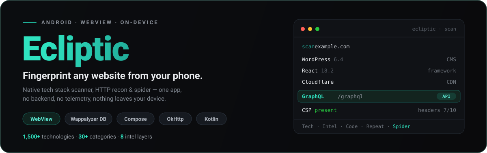
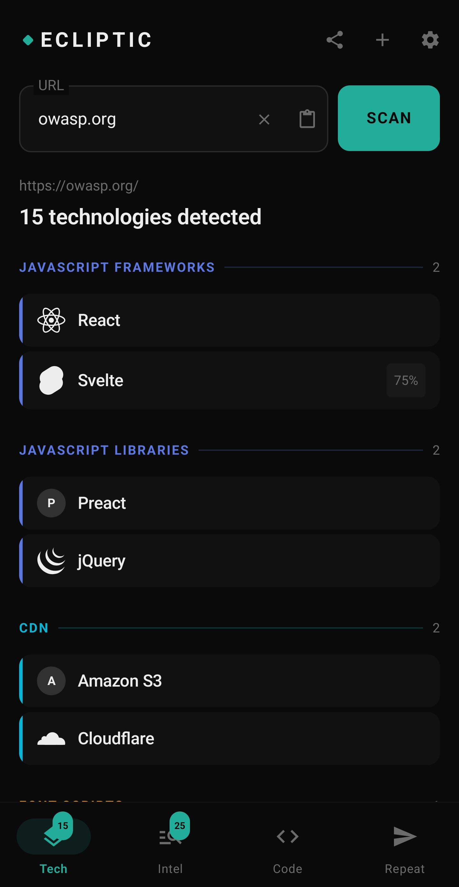
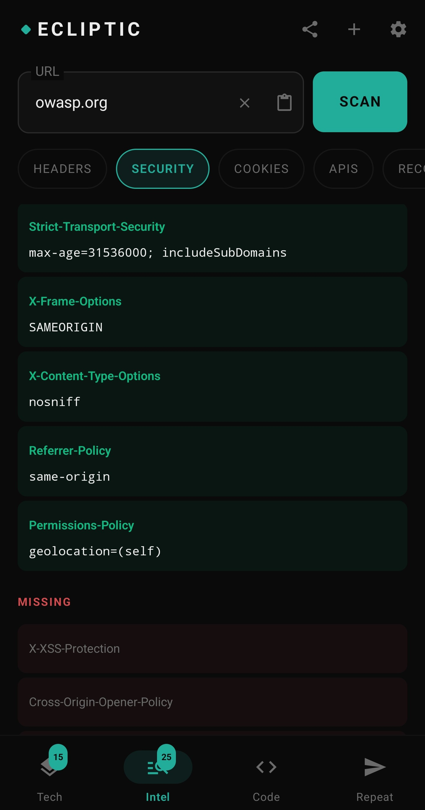
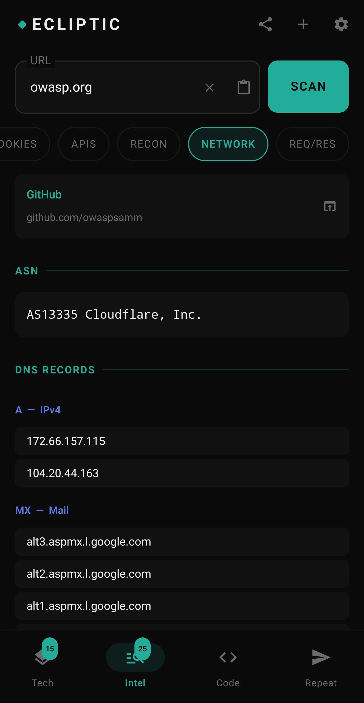
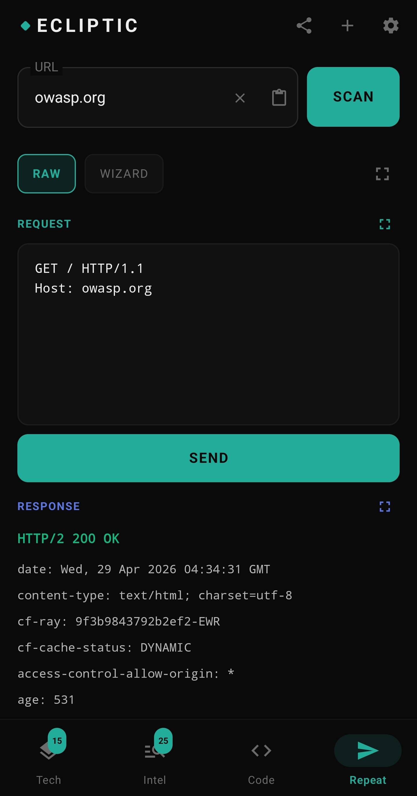
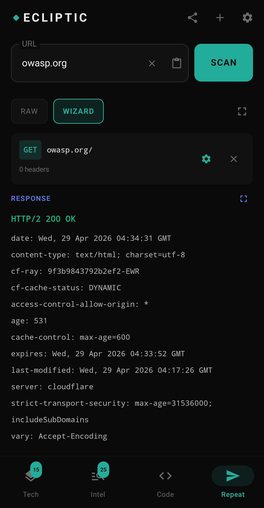

<div align="center">



<p align="center">
  <a href="https://developer.android.com"></a>
  <a href="https://developer.android.com/about/versions/oreo"></a>
  <a href="https://kotlinlang.org"></a>
  <a href="https://developer.android.com/jetpack/compose"></a>
  
  <a href="LICENSE"></a>
</p>

<p align="center">
  <a href="https://naturalstate.github.io/ecliptic/"><b>🌐 Website</b></a> &nbsp;&middot;&nbsp;
  <a href="#features-at-a-glance"><b>Features</b></a> &nbsp;&middot;&nbsp;
  <a href="#screenshots"><b>Screenshots</b></a> &nbsp;&middot;&nbsp;
  <a href="#how-the-scan-works"><b>How it works</b></a> &nbsp;&middot;&nbsp;
  <a href="#installation"><b>Install</b></a> &nbsp;&middot;&nbsp;
  <a href="#roadmap"><b>Roadmap</b></a>
</p>

</div>

---

## What is Ecliptic?

Ecliptic is a native Android app that gives you instant, deep intelligence on any website. Point it at a URL, or share directly from Chrome, and it fingerprints the entire tech stack using three independent analysis layers: live HTTP headers, HTML source analysis, and JavaScript runtime probing via a real Chromium engine (Android WebView).

Think of it as a pocket-sized combination of Wappalyzer, a security-header analyzer, an HTTP repeater, a site spider, and a full OSINT/recon suite, DNS & email-security posture, subdomains, hosting and IP neighbors, look-alike domains, alt-port and staging-host discovery, with everything running entirely on your device. No account, no backend, no telemetry.

---

## Screenshots

<div align="center">

| Tech Detection | Security Headers | Network & DNS | HTTP Repeater |
|:-:|:-:|:-:|:-:|
|  |  |  |  |
| Detect 1,500+ technologies across 30+ categories | Full security header audit with live scoring | TLS certificate, DNS records, ASN lookup | Send custom raw or wizard-built HTTP requests |

</div>

---

## Features at a Glance

```
🔍  Technology fingerprinting    →  1,500+ technologies, 30+ categories
🛡️  Security header analysis     →  pass/fail + depth: CSP, CORS, SRI, HSTS, clickjacking
📧  DNS & email security         →  SPF, DMARC, DKIM, DNSSEC, CAA, HTTPS enforcement
🔑  Trust signals                →  domain age, DNSSEC, HTTPS, email auth, look-alikes
🌍  Subdomains                   →  certificate-transparency enumeration (crt.sh)
🖧  Hosting & IP intel           →  ASN, reverse-IP neighbors, dedicated vs shared
🚪  Alt-port probe               →  common non-standard web/admin/dev ports
🧪  Staging-host enumeration     →  tiered wordlists + provider defaults (DNS-resolved)
🤖  Build-origin estimate        →  AI site-builder fingerprint + LLM comment-style heuristic
🍪  Deep cookie inspection       →  HttpOnly, Secure, SameSite, expiry, domain
⚡  API detection                →  REST, GraphQL, SOAP, gRPC, JSON-RPC, OpenAPI, WebSocket
🕸️  Spider                       →  Crawl a site into a page map (sitemap + link following)
🌐  Network recon                →  TLS cert, DNS (A/CNAME/MX/NS/TXT), ASN, social links
📋  WHOIS / RDAP                 →  Registrar, dates, name servers
🤖  Recon files                  →  robots.txt, security.txt, sitemaps
🔁  HTTP Repeater                →  RAW and wizard modes, fullscreen response
👁️  Source viewer                →  HTML, JS globals, DOM tree, live network, console
📤  Chrome Share integration     →  Share any URL from Chrome → instant scan
🕑  Scan history                 →  Up to 50 scans, persistent, ← → navigation, delete
📋  Copy anywhere                →  Long-press any value, or bulk-copy a tab
📊  HTML report export           →  Full scan exported as a shareable HTML file
```

> **Works behind bot protection.** Network requests automatically fall back to a plain User-Agent when a site's WAF (e.g. Cloudflare) blocks browser-like clients, so the Spider, Recon and header fetches still work on protected sites.

---

## Detection Capabilities

### 🔬 Technology Fingerprinting

Powered by the [enthec/webappanalyzer](https://github.com/enthec/webappanalyzer) signature database, the same engine behind Wappalyzer, running entirely on-device. Detection uses layered signals:

| Layer | What it checks |
|---|---|
| **HTTP Headers** | `X-Powered-By`, `Server`, `X-Generator`, `CF-Ray`, cache headers |
| **HTML Analysis** | Meta tags, script/CSS URLs, HTML attributes, body classes, title |
| **JS Runtime** | Live JavaScript global probing via injected scripts in Chromium WebView |
| **DOM & CSS** | Verified DOM selectors (attributes + JS properties) and CSS custom properties |

**Accurate framework detection:** JavaScript-framework signals are corroborated against strong markers (specific globals, script URLs, verified DOM properties) rather than generic selectors, so you don't see React or Svelte reported on sites that don't actually use them.

**Detected categories include:** CMS, JavaScript Frameworks, CSS Frameworks, UI Libraries, Analytics, Tag Managers, CDN, Web Servers, Databases, Programming Languages, Caching, Authentication, Ecommerce, Video, Mapping, Advertising, A/B Testing, and more.

**Smart grouping:** Major CMS platforms (WordPress, Shopify, Drupal, Joomla, etc.) sort to the top of their category. Payment card brands (Visa, Mastercard, Amex, Discover, etc.) are grouped into a single "Major Credit Cards" entry.

**Full logo coverage:** every detected technology shows its real logo. The lean icons from the Wappalyzer / webappanalyzer icon set are bundled for offline use; the few oversized ones load from the upstream repo on demand (cached). No more letter-placeholders for things like Next.js, Open Graph or Google Tag Manager.

---

### 🛡️ Security Headers

Dedicated audit tab scoring 10 critical security headers:

| Header | What it protects |
|---|---|
| `Content-Security-Policy` | XSS, code injection |
| `Strict-Transport-Security` | Protocol downgrade attacks |
| `X-Frame-Options` | Clickjacking |
| `X-Content-Type-Options` | MIME-type sniffing |
| `Referrer-Policy` | Information leakage |
| `Permissions-Policy` | Browser feature access |
| `X-XSS-Protection` | Reflected XSS (legacy) |
| `Cross-Origin-Opener-Policy` | Cross-origin isolation |
| `Cross-Origin-Embedder-Policy` | Spectre mitigations |
| `Cross-Origin-Resource-Policy` | Cross-origin data leaks |

Present headers shown in full with their values. Missing headers flagged in red. **Tap any header** (or an analysis finding) for a plain-language definition and a link to the canonical MDN / OWASP reference, so you can learn the concept on the spot.

**Security-depth analysis (ANALYSIS section).** Beyond present/absent, the SEC HEADERS tab runs a static analyzer that flags *weak* configurations, each with the offending value and a severity (alert / warn / ok / info):

- **Clickjacking**, missing/weak `X-Frame-Options` and absent `frame-ancestors` in CSP
- **CSP quality**, `unsafe-inline`, `unsafe-eval`, wildcard sources
- **CORS misconfiguration**, wildcard `Access-Control-Allow-Origin`, and the dangerous `*` + credentials combination (flagged alert)
- **SRI**, third-party `<script>` / `<link>` loaded without a Subresource Integrity hash
- **HSTS**, `max-age`, `includeSubDomains`, `preload` completeness
- **Mixed content** and **information disclosure** (`X-Powered-By`, versioned `Server`)

No vanity letter grade, findings are reported straight, with the raw evidence.

---

### 📧 DNS & Email Security

Checks the DNS records that decide whether a domain can be spoofed, shown as clear pass/fail with the raw record values:

| Check | What it verifies |
|---|---|
| **SPF** | Sender Policy Framework TXT record |
| **DMARC** | `_dmarc` policy (`p=none/quarantine/reject`) |
| **DKIM** | Common selectors probed for a signing key |
| **DNSSEC** | Zone signed (DNSKEY present) |
| **CAA** | Certificate Authority Authorization records |
| **HTTP → HTTPS** | Whether `http://` is redirected to `https://` |

### 🔑 Trust Signals

Keyless reputation context (no API key required): domain age from registration data, DNSSEC, enforced HTTPS, email authentication, and **registered look-alike / typosquat domains** that could impersonate the target. Blocklist status is shown honestly as "needs an API key" rather than failing silently.

### 🌍 Subdomains, Hosting & Look-alikes

- **Subdomains**, enumerated from certificate-transparency logs (crt.sh)
- **IP neighbors**, reverse-IP lookup of other sites sharing the host, flagging **dedicated vs shared** hosting
- **Similar domains**, generated typosquats (TLD swaps, omissions, transpositions, homoglyphs) filtered to the ones that actually resolve

### 🚪 Alt-Port Probe & 🧪 Staging Enumeration

On-demand (manual) recon run from the Recon tab, intended for hosts you own or are authorized to test:

- **Alt ports**, bounded-parallel TCP probe of 27 common non-standard web/admin/dev ports, reporting open ports and their likely service. The exact list is disclosed in-app (RECON → "Which ports are checked?") and here:

  | Port | Service | Port | Service | Port | Service |
  |---|---|---|---|---|---|
  | 81 | HTTP-alt | 2096 | Webmail (SSL) | 8081 | HTTP-alt |
  | 88 | HTTP/Kerberos | 3000 | Node/Grafana | 8088 | HTTP-alt |
  | 591 | HTTP-alt | 4000 | Dev server | 8443 | HTTPS-alt |
  | 2082 | cPanel | 5000 | Flask/Dev | 8444 | HTTPS-alt |
  | 2083 | cPanel (SSL) | 7001 | WebLogic | 8888 | HTTP-alt |
  | 2086 | WHM | 8000 | HTTP-alt | 9000 | PHP-FPM/SonarQube |
  | 2087 | WHM (SSL) | 8008 | HTTP-alt | 9001 | Supervisor |
  | 2095 | Webmail | 8080 | HTTP-proxy | 9090 | Prometheus/Admin |
  | | | | | 9200 | Elasticsearch |
  | | | | | 9443 | HTTPS-alt |
  | | | | | 10000 | Webmin |
- **Staging hosts**, tiered enumeration (**Quick ~10 / Standard ~30 / Deep ~80**) of common staging/pre-prod prefixes (`staging.`, `dev.`, `uat.`…), DNS-resolved in parallel; recognized hosts (WP Engine, Pantheon, Kinsta, Acquia, Flywheel, Netlify, Cloudways, Platform.sh) also get their **provider-default** staging patterns injected

Both results are cached per scan, persist across restarts, and are included in the exported HTML report.

---

### 🤖 Build-Origin Estimate

An honest, evidence-first guess at whether a site was built with the help of an AI coding tool. Two independent tiers, shown in the RECON tab:

- **Platform fingerprint (high confidence)**, AI *site builders* leave hard markers in the shipped page. Ecliptic names the platform when it finds one, e.g. **Lovable** (`gptengineer.js`), **v0 by Vercel**, **bolt.new**, **Replit Agent**, **Framer**, **Durable**, **Wix ADI**, **Softr**, **Builder.io**.
- **LLM comment-style heuristic (soft)**, over-commenting and recognisable phrasings ("in a real app", "for now", obvious one-line comments, emoji in comments, JSDoc on trivial functions) produce a confidence band and a label: *Appears heavily LLM-developed*, *Mixed codebase*, or *Minimal LLM comment markers*. Only meaningful on unminified source, so minified bundles are reported honestly as inconclusive.

It never claims *which* model wrote the code (Claude vs GPT vs others): that is not reliably recoverable from shipped code. The HTML + headers are analysed automatically; **Analyze bundled JS** fetches the top scripts for a deeper comment pass. The matched evidence is always shown, and there is no vanity score.

---

### ⚡ API Detection

Finds the API endpoints a site actually uses, from the XHR/fetch requests captured during page load, the HTML source, and referenced asset URLs. Each entry shows the **concrete endpoint URL** where identifiable, grouped by type:

- **REST**, `/api/…`, `/v1…`, `api.` hosts and conventional REST endpoints
- **GraphQL**, endpoint paths, `__schema`/`__typename` hints
- **WebSocket**, `ws://`/`wss://` endpoints, `new WebSocket()` calls, Socket.IO usage
- **JSON-RPC**, `jsonrpc` / `json-rpc` references
- **SOAP**, WSDL references, `SOAPAction` headers
- **gRPC**, `application/grpc` content type, `grpc-web` markers
- **OpenAPI / Swagger**, `swagger`, `openapi`, `api-docs` references

Endpoints are de-duplicated and copyable; protocol hints without a concrete URL are still listed.

---

### 🕸️ Spider

Crawl a site into a map of its pages, right from the Intel tab, to the right of Recon.

- **Sitemap-first**, seeds from `robots.txt` and common sitemap paths (`/sitemap.xml`, `/sitemap_index.xml`, `/sitemaps.xml`, `/wp-sitemap.xml`), **following sitemap indexes** down to real page URLs to minimise traffic
- **Link following**, also harvests `<a href>` links from the page source when no sitemap exists
- **Same-site & polite**, stays on one host (treats `www` and apex as the same site), with a conservative page/depth cap and a short delay between requests
- **Controls**, Start / Pause / Stop, live progress, and one-tap **copy** of the full URL list
- Each scan's spider is its own, results never bleed between scans

---

### 🌐 Network Tab

<div align="center">

</div>

- **TLS Certificate**, Protocol version, cipher suite, subject, issuer, validity period, Subject Alternative Names (SANs)
- **DNS Records**, Live lookup via Google DNS-over-HTTPS: A, CNAME, MX, NS, TXT records
- **ASN**, Autonomous System Number and organisation lookup (via ipinfo.io) from first A record
- **Social Links**, Twitter/X, Facebook, Instagram, LinkedIn, YouTube, GitHub, TikTok, Pinterest links extracted from page source

---

### 🤖 Recon Tab

The Recon sub-tab aggregates everything OSINT in one place (auto-loaded once per scan, cached, with a manual refresh):

- **Wayback Machine**, Direct link to archive.org history for the scanned URL
- **WHOIS / RDAP**, Registrar, registrant, creation/expiry/updated dates, domain status, name servers
- **DNS & email security**, SPF, DMARC, DKIM, DNSSEC, CAA, HTTP→HTTPS (see above)
- **Alt ports**, manual TCP probe of common non-standard ports
- **Staging hosts**, manual tiered enumeration + provider defaults
- **Subdomains / IP neighbors / Similar domains**, surfaced here and in the report
- **robots.txt**, Fetched live, collapsible full view
- **security.txt**, Fetched from `/.well-known/security.txt` and `/security.txt`
- **sitemap**, Discovered via `robots.txt` and common paths (`/sitemap.xml`, `/sitemap_index.xml`, `/sitemaps.xml`, `/wp-sitemap.xml`)

---

### 🍪 Cookie Inspector

Full `Set-Cookie` header parsing, not just name/value:

| Attribute | Shown |
|---|---|
| Name & Value | ✅ |
| Domain | ✅ |
| Path | ✅ |
| Expires / Max-Age | ✅ |
| HttpOnly | ✅ flag chip |
| Secure | ✅ flag chip |
| SameSite | ✅ flag chip |

**Known vs proprietary.** Each cookie is checked against the [Open Cookie Database](https://github.com/jkwakman/Open-Cookie-Database) (bundled, ~2,300 entries). Recognised cookies are tagged with the platform that sets them and a category (e.g. `_ga` → Google Analytics · Analytics); unrecognised ones are flagged `proprietary / unknown`. Tap a cookie for its description, retention and source.

---

### 📋 Headers Tab

- **Request headers**, exactly what Ecliptic sent to the server
- **Response headers**, full server response headers
- **Security Headers**, dedicated sub-tab with score and full values (see above)

---

### 👁️ Code Tab

- **HTML Source**, Syntax-highlighted HTML viewer with search, remote CSS/JS file loading, save to Downloads, fullscreen mode
- **Strings**, extracted secrets, tokens, JWTs, emails, IPs and comments, each tagged with its origin (HTML vs JS); tap any finding to copy it, jump to it in the Source viewer, or open it in a browser
- **JS Globals**, Every `window.*` global detected at runtime, including framework markers, config objects, feature flags
- **DOM Tree**, Collapsible interactive DOM tree with tag names, IDs, classes, attributes
- **Network Requests**, All requests captured during page load, filterable by type (script, XHR, image, font, media)
- **Console**, Live JS console with eval support, run JavaScript in the page context directly from the app

---

### 🕑 Scan History

Every scan is automatically saved to device storage and survives app restarts.

- **Persistent storage**, up to 50 scans saved as JSON files in internal storage (auto-pruned oldest)
- **← → navigation**, arrows appear in the header once you have multiple scans; tap to browse previous results (press-and-hold to fast-advance)
- **Delete a scan**, trash icon in the header removes the scan in view (with a confirm), from memory and disk
- **Full fidelity**, saved scans restore tech list, headers, cookies, TLS, APIs, recon (DNS/WHOIS/security/subdomains/ports/staging), and network requests
- **Save HTML source**, optional setting (off by default) to also persist raw HTML (~500 KB extra per scan)

---

### 📋 Copy & Export

- **Long-press any value**, select and copy any single-line value natively (headers, cookies, API endpoints, TLS fields, URLs, tech names), no per-field button clutter
- **Bulk copy**, copy buttons on data-heavy tabs copy the whole tab at once
- **Export report**, tap the share icon in the header after any scan to export a full styled HTML report covering all findings

---

### 🔁 HTTP Repeater

<div align="center">

</div>

Two modes for crafting and replaying HTTP requests:

**RAW mode**
- Editable raw HTTP request editor (method, path, headers, body)
- Full-screen request and response panes, independently expandable
- Syntax-coloured response viewer

**WIZARD mode**
- Visual request builder: URL, method chips, header management, body editor
- Pre-populated from scan results, URL, method, and captured headers seeded automatically
- Common headers quick-add chips (User-Agent, Accept, Content-Type, Authorization, etc.)

**REQ / RES Intel sub-tab**
- Split-screen read-only view of the original scan request and response
- Per-pane fullscreen expand, search/filter with highlight, scroll navigation

---

## How the Scan Works

```
URL input / Chrome Share intent
         │
         ▼
┌─────────────────────┐
│  OkHttp request     │  ← Response headers, TLS handshake, Set-Cookie, redirects
│  (network layer)    │    (plain-UA fallback for WAF-protected sites)
└────────┬────────────┘
         │
         ▼
┌─────────────────────┐
│  Android WebView    │  ← Loads the real page in Chromium; JS injection probes
│  (Chromium engine)  │    window globals, DOM, meta tags, script URLs, network
└────────┬────────────┘
         │
         ▼
┌─────────────────────┐
│  Signal aggregation │  ← Merges headers + HTML + JS globals + DOM/CSS,
│  + fingerprinting   │    runs against the webappanalyzer DB
└────────┬────────────┘
         │
         ▼
   Results across Tech / Intel / Code / Repeat tabs
```

---

## Tech Stack

| Layer | Technology |
|---|---|
| Language | Kotlin |
| UI | Jetpack Compose (Material 3) |
| Architecture | MVVM + StateFlow |
| HTTP client | OkHttp |
| WebView engine | Android WebView (Chromium) |
| Fingerprint DB | enthec/webappanalyzer (bundled as assets) |
| Image loading | Coil |
| Min SDK | API 26 (Android 8.0) |
| Backend | None, everything runs on-device |

---

## Installation

### Option A: Install APK directly

1. Download the latest APK from [Releases](https://github.com/naturalstate/ecliptic/releases)
2. Enable **Install from unknown sources** on your Android device
3. Install and open Ecliptic

### Option B: Build from source

```bash
git clone https://github.com/naturalstate/ecliptic.git
cd ecliptic

# Open in Android Studio, or build from CLI:
./gradlew assembleDebug

# APK output:
# app/build/outputs/apk/debug/app-debug.apk
```

Requires Android Studio Hedgehog or later, JDK 17+.

---

## Usage

**Basic scan**
1. Type or paste any URL into the input field (no `https://` needed; an explicit `http://` is respected)
2. Tap **SCAN**
3. Browse results across the four tabs: **TECH**, **INTEL**, **CODE**, **REPEAT**

**Share from Chrome**
1. Open any website in Chrome
2. Tap Share → **Ecliptic**
3. App opens instantly and begins scanning

**Spider a site**
1. After a scan, open **INTEL → SPIDER**
2. Tap **Start**, Ecliptic seeds from the sitemap (if any) and follows links
3. Pause/Stop anytime; tap copy to export the URL list

**Recon & enumeration**
1. Open **INTEL → RECON**, DNS/email security, WHOIS, subdomains and hosting load automatically
2. Tap **Scan common ports** to probe alt ports, or pick a **staging** depth (Quick / Standard / Deep) to enumerate pre-prod hosts
3. Only run port/staging enumeration against hosts you own or are authorized to test

> The INTEL sub-tabs are: **HEADERS · SEC HEADERS · COOKIES · APIS · RECON · PARAM · SPIDER · NETWORK · REQ/RES**. Use the header trash icon to delete the scan in view.

---

## Roadmap

- [x] Scan history, persistent across sessions with ← → navigation, delete
- [x] Export scan report, full HTML report via share sheet
- [x] Copy, long-press any value plus per-tab bulk copy
- [x] Spider, crawl a site into a page map
- [x] WebSocket detection (API tab)
- [x] Security-depth analysis, CSP / CORS / SRI / HSTS / clickjacking
- [x] DNS & email security, SPF / DMARC / DKIM / DNSSEC / CAA
- [x] Trust signals, domain age, DNSSEC, HTTPS, email auth, look-alikes
- [x] Subdomains, IP neighbors & hosting intel
- [x] Alt-port probe & staging-host enumeration
- [x] Build-origin estimate, AI site-builder fingerprint + LLM comment-style heuristic
- [x] Strings provenance, origin tagging + tap-to-copy / jump-to-source
- [x] Inline learning, tap a security header or finding for a definition + MDN/OWASP link
- [x] Cookie classification, known vs proprietary via the Open Cookie Database
- [ ] Active subdomain brute-force, bundled SecLists wordlists, start/pause/stop
- [ ] Authorized-use acknowledgement gate (pre-Play)
- [ ] Authenticated scans, cookie / token / interactive login
- [ ] Scan comparison, diff two saved scans side-by-side
- [ ] Favicon hash (Shodan-style) identification
- [ ] Server-Sent Events (SSE) detection
- [ ] Service Worker / PWA detection
- [ ] Auth mechanism hints (JWT, OAuth, OIDC)
- [ ] cURL import in Repeater
- [ ] Play Store release

---

## Disclaimer

Ecliptic's results are a **best-effort approximation, not a guarantee**. Detection is heuristic and based on a single page snapshot, so there will be false positives and missed technologies. The build-origin estimate, cookie classification, staging/port enumeration and similar features are informed guesses, not authoritative facts. Verify anything important independently before relying on it. Use the recon features only against hosts you own or are authorized to test.

---

## Contributing

Pull requests are welcome. For major changes, please open an issue first.

```bash
# Run tests and a debug build before submitting
./gradlew test assembleDebug
```

---

## License

[MIT](LICENSE) © Ryan Denham

---

<div align="center">

Built for developers and security researchers who live on their phones.

**[Report a Bug](https://github.com/naturalstate/ecliptic/issues) · [Request a Feature](https://github.com/naturalstate/ecliptic/issues) · [Releases](https://github.com/naturalstate/ecliptic/releases)**

</div>
